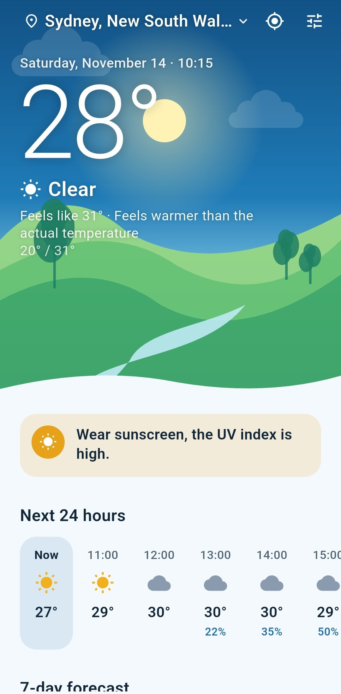
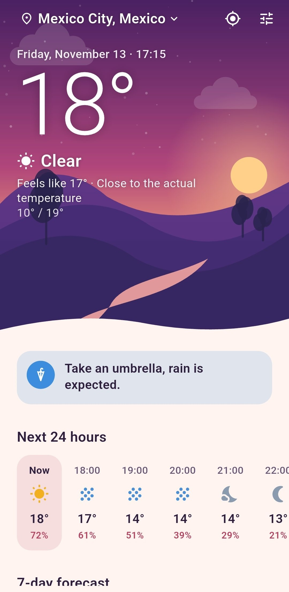
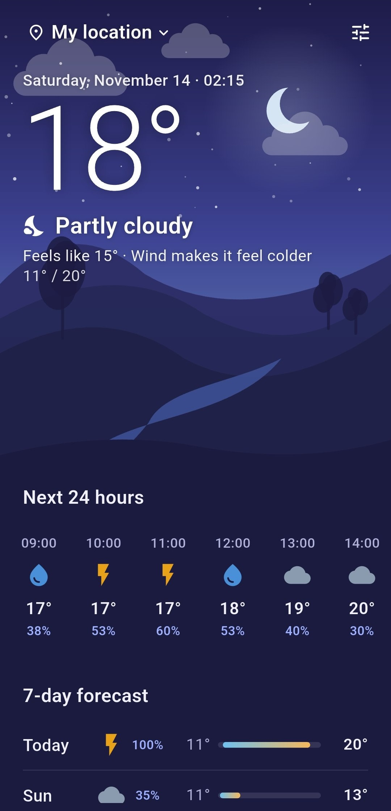
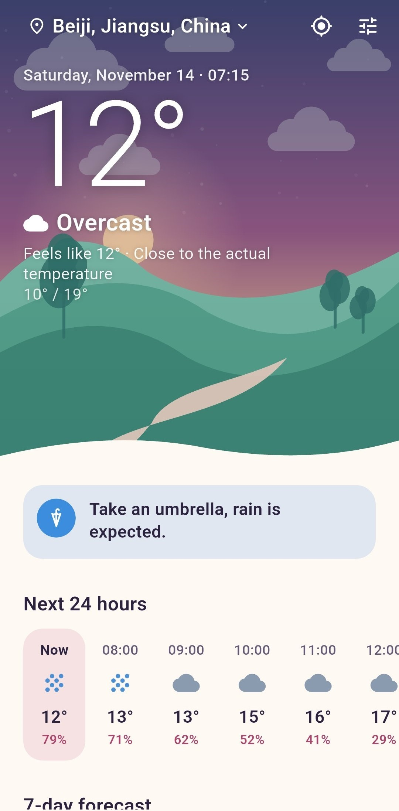
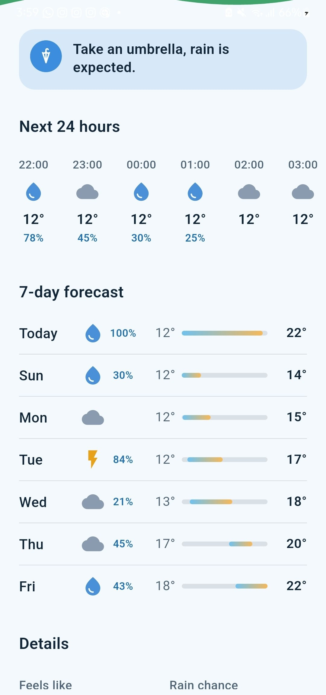
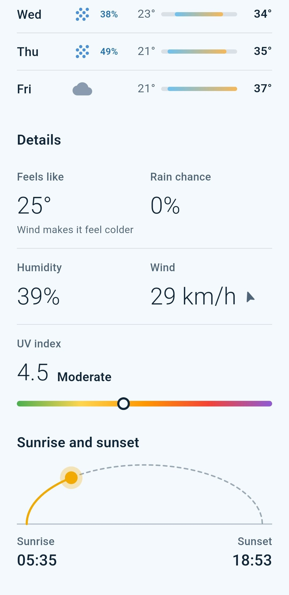
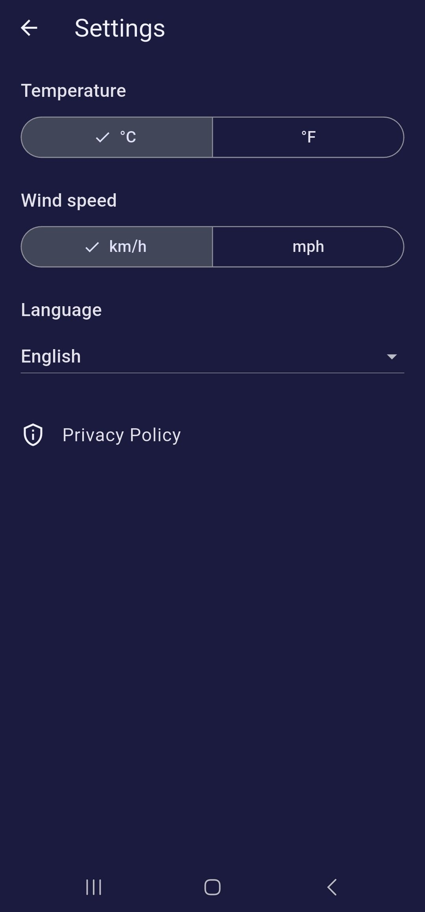
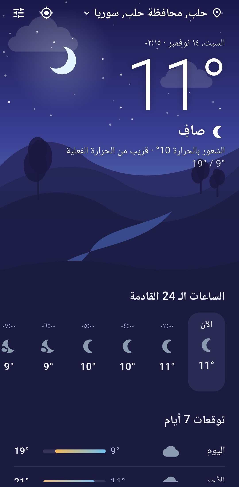
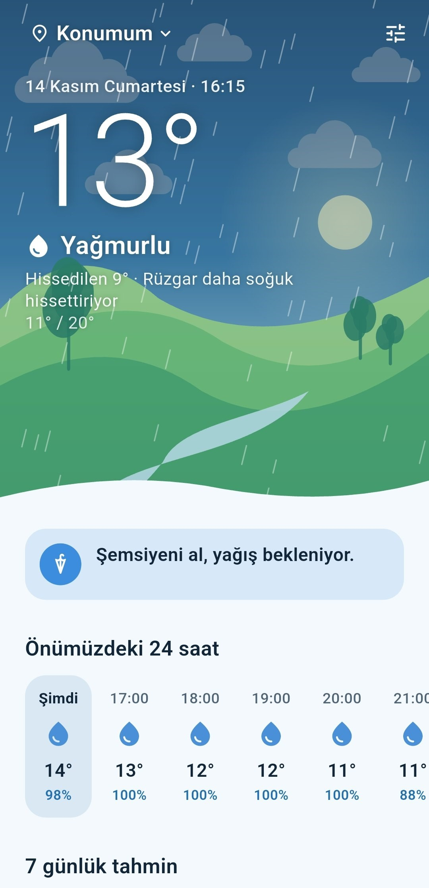
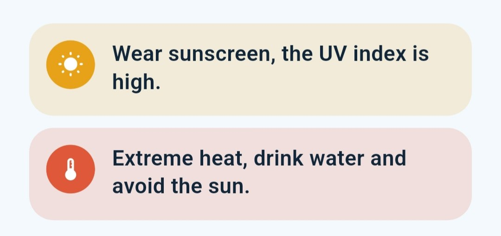

# Woosh

A Flutter weather app with a sky that follows real sunrise and sunset. Three languages (English, Turkish, Arabic with right-to-left layout), offline mode and saved cities.

<p align="center">
  
  
  
</p>

## Demo

- **Web demo:** _coming soon_
- **Android APK:** _coming soon_ (see the Releases page)

## Features

- Live weather with hourly and 7-day forecast
- Weather alerts
- Sky that follows the real sunrise and sunset of the selected city
- Saved cities (add, delete, switch)
- GPS location button
- English, Turkish and Arabic, including right-to-left layout
- Offline mode with saved data and an offline banner
- Units: °C / °F and km/h / mph
- Privacy policy link in Settings

## Screenshots

| Sunrise | Day | Sunset | Night |
|---|---|---|---|
|  |  |  |  |

| Forecast | Details | Favorites | Settings |
|---|---|---|---|
|  |  |  |  |

| Arabic (RTL) | Turkish |
|---|---|
|  |  |

| Alerts | | | |
|---|---|---|---|
|  |  |  |  |

## Tech

Flutter, Riverpod, Open-Meteo API, geolocator, shared_preferences, url_launcher, localization with `.arb` files.

## Interesting parts

- **Offline "now":** cached data is aged so the current conditions stay correct without a connection.
- **API time, not phone clock:** the sky and hours use the time from the API for the selected city.
- **Readable on every sky:** contrast tests make sure text stays readable in dawn, day, sunset and night themes.

## Privacy

Woosh uses approximate location only to show weather. No account, no ads, no analytics. Saved cities and settings stay on the device. Requests go to Open-Meteo over HTTPS.
[Privacy Policy](https://sites.google.com/view/woosh-privacy)

## Run it

```bash
flutter pub get
flutter gen-l10n
flutter run
```

Run the tests:

```bash
flutter test
flutter analyze
```

## Credits

Weather data by [Open-Meteo](https://open-meteo.com).